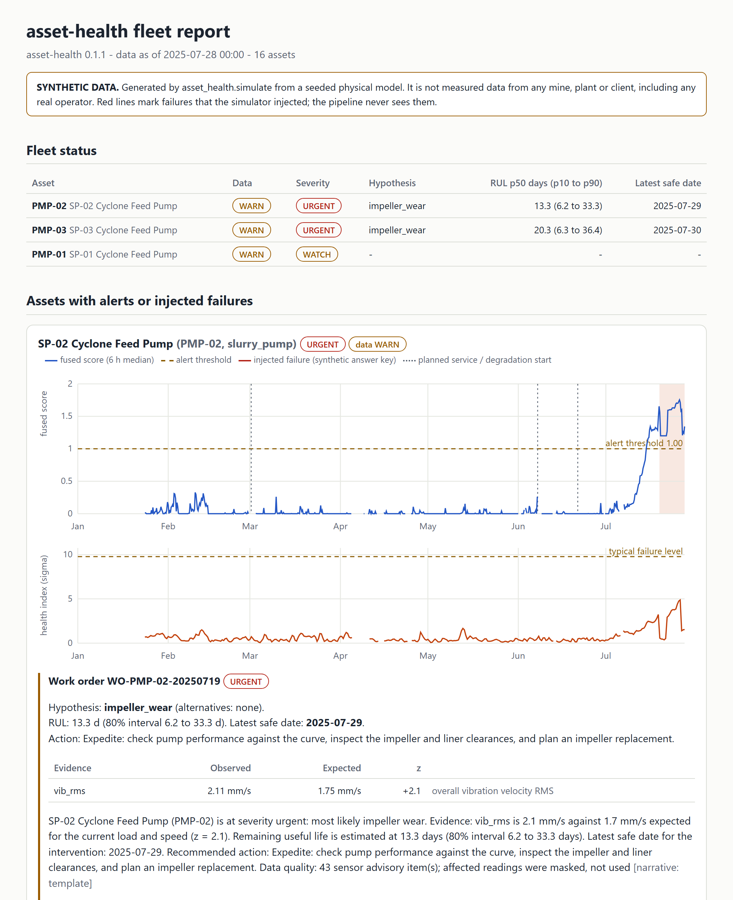
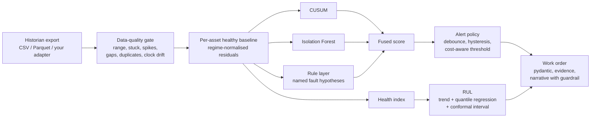

<picture>
  <source media="(prefers-color-scheme: dark)" srcset="docs/assets/header-dark.svg">
  <source media="(prefers-color-scheme: light)" srcset="docs/assets/header-light.svg">
  
</picture>

# asset-health: offline predictive maintenance for mining assets, scored one failure at a time

[](https://github.com/darrshangovender/asset-health/actions/workflows/tests.yml)
[](LICENSE)
[](https://python.org)
[](docs/METHODOLOGY.md)

> A seeded, physically motivated simulator of a mine's conveyor, crusher, slurry-pump and haul-truck fleet, and the pipeline that watches it: a data-quality gate, regime-normalised features, CUSUM + Isolation Forest + an explainable rule layer, remaining useful life with a conservative interval, cost-aware alerts and structured work orders. It is judged per failure event, on seeds it never trained or tuned on, against tuned statistical alarm limits and age-based replacement, and at failure signatures down to 0.15x their designed size.

**Why this exists.** Predictive-maintenance demos usually end with a curve that goes up before a failure. The questions a reliability engineer asks next are the ones that decide whether the thing is usable. Does a busy shift raise an alarm? What does a frozen transmitter or a 65535 sentinel do? How early, how often wrong, and at what cost compared with simple alarm limits or replacing parts on a schedule? How small a fault can it still see? And was any of it tuned on the data it is scored on? This repo is built around those questions. Everything runs offline with no API key, and **every dataset in it is synthetic**: none of it is measured data from any mine, plant or client. The sibling repo [maintenance-agent](https://github.com/darrshangovender/maintenance-agent) starts where this one ends, with an asset-health alert in hand; the two share no code.

---

## Quick start

```bash
git clone https://github.com/darrshangovender/asset-health && cd asset-health
python -m venv .venv && source .venv/bin/activate        # Windows: .venv\Scripts\activate
pip install -e ".[dev]"

asset-health simulate --seed 42 --out out/demo           # 16 assets x 270 days, SYNTHETIC
asset-health check out/demo                              # data-quality report per asset
asset-health report out/demo --as-of 2025-07-28 --out out/report.html   # detection, RUL, work orders
```

Open `out/report.html` (self-contained, no network). `--as-of` replays the fleet as it stood at the start of that date (UTC), reading nothing stamped later, the data-quality gate included: by the end of the data every failed part has been replaced, so a mid-degradation date is the one with open work orders. `asset-health detect out/demo --as-of 2025-07-28` lists the alerts and `asset-health rul out/demo --as-of 2025-07-28` prints the remaining useful life, as an interval, for every open alert; each of the three re-runs the pipeline (`--jobs N` sets the worker processes). Timing on a 2015 dual-core laptop that was busy with other jobs: `simulate` and `check` about a minute each including Python start-up, `report` about three minutes; a current machine should be several times faster (not measured). For a five-asset fleet, add `--small` to `simulate`. `make demo` runs the whole sequence. An export sampled faster than hourly is refused by `check` and the analysis commands; add `--resample` to average it onto the hourly grid.

```python
import pandas as pd

from asset_health.analysis import analyse_source
from asset_health.ingest import open_source

analysis = analyse_source(open_source("out/demo"), as_of=pd.Timestamp("2025-07-28"))
for wo in analysis.all_work_orders():
    print(wo.asset_id, wo.severity.value, wo.failure_mode_hypothesis.value, wo.latest_safe_date)
    print(wo.narrative)
```

To regenerate every number below: `python benchmarks/run.py` (full) or `python benchmarks/run.py --quick` (smoke run, writes nothing). `python examples/quickstart.py` does an in-memory end-to-end run, and `python examples/guardrail_demo.py` shows the narrative guardrail with stub "LLMs".



*The committed example, [docs/example-report.html](docs/example-report.html), is the default seed (42) replayed as of 28 July 2025; the screenshot trims its healthy rows. Red lines are failures the simulator injected, and the pipeline never sees them. In that seed's `ground_truth.json` PMP-02 fails on 8 August (11 days after the snapshot), inside its interval of 6.2 to 33.3 days, and PMP-03 fails on 3 September (37 days after), just outside its interval of 6.3 to 36.4 days. The date was chosen so that alerts are open; the intervals are what the default seed gives.*

## How it works



**Simulator** (`simulate/`). Five asset types, each with real bearing geometry. Vibration is synthesised as an order-tracked spectrum, so a defect line sits at BPFO or BPFI times shaft speed whatever the speed, and band energies are integrals of that spectrum. That assumes an edge analyser that order-tracks against a tachometer; many wireless nodes publish fixed-frequency bands and overall values instead (see Limitations). Load, speed and ambient temperature follow shift, weekly, campaign and seasonal patterns with stoppages. Each monitored component has an age and a wear-out life (Weibull, shape above 1, per asset class), so older parts fail sooner and replacing a part early does prevent its failure. Four failure modes degrade the channels they would physically disturb, along a back-loaded severity curve, ending in a ground-truth failure time and a repair record; `SimConfig.degradation_scale` shrinks every signature for the severity sweep:

| Asset type | Failure mode | What moves |
|---|---|---|
| Conveyor idler, pulley, crusher, slurry pump | bearing spall (outer or inner race) | race-frequency bands, then the 20-32x order band ('hf' in the code), temperature |
| Slurry pump | impeller wear | discharge pressure and flow fall at a given speed, vane-pass energy rises |
| Primary crusher | liner wear | power falls at a given feed, impact-order energy rises |
| Haul-truck engine | overheating | temperature above the regime-expected value, 20-32x order band |

On top of that sit historian faults, each logged as ground truth so the data-quality gate can be scored: dropouts, stuck transmitters, sentinel codes (-999, 9999, 65535), isolated spikes, gateway outages, replayed rows, and logger clocks that drift and step.

**Data-quality gate** (`ingest/`). Converts every timestamp to UTC, then checks the structure of the export before building anything: rows out of time order, two collectors interleaved, a cadence that is not the configured one, or a grid that would run past the last real timestamp **block** the asset (a cleanly newest-first file is reversed and flagged). It then rebuilds the sampling grid from the sample sequence (so a drifting logger clock does not create phantom gaps), drops replays, masks out-of-range, frozen and spiking readings and erratic vibration (a loose accelerometer) with `NaN`, and reports a pass/warn/fail per check and per channel. An asset whose data cannot support a decision is **blocked**, not scored. Masked values never reach a detector, and a masked hour neither opens nor clears an alert.

**Features** (`features/`). Per asset, a ridge regression of every channel on the operating regime (load, lagged load, speed and their products) is fitted on the asset's own commissioning window, and the residual divided by its held-out robust sigma is what the detectors see. Temperature is modelled as rise above ambient for passively cooled assets, and readings outside the operating envelope of the baseline are left undefined rather than extrapolated. After a repair record the baseline is re-learned. This is a statistical reference model of normal behaviour, not a physics-based digital twin.

**Detection** (`detect/`). A two-sided CUSUM per channel, an Isolation Forest on the multivariate residual vector, and a rule layer that names a hypothesis (outer-race defect, inner-race defect, generic bearing wear, impeller wear, liner wear, overheating) and the evidence behind it. They are fused into one score.

**RUL** (`rul/`). A mode-agnostic health index (mean of the three largest harmful residuals) is extrapolated to the level at which assets of this kind have failed, with a Theil-Sen slope and Monte-Carlo failure level. A quantile-regression model, trained on development seeds, maps the trend, the index, its slope, the age of the degradation and the asset class's typical P-F interval to the 10th, 50th and 90th percentile of true RUL; a split-conformal margin fitted on separate calibration seeds widens the interval to its target coverage. The result is always an interval, and `not_degrading` or `insufficient_trend` when there is nothing honest to say.

**Alerting** (`alerting/`). An alert opens after a debounce and closes with hysteresis. The threshold can scale with the cost of missing a failure on that asset class (`cost_exponent`); tuning on the development seeds set that exponent to 0, so in the shipped configuration it does not. Severity (watch, warning, urgent, critical) follows the RUL interval, and the latest safe date is the replacement day that minimises expected cost under a log-normal fit to that interval, never later than its pessimistic end. A work order is a pydantic object: asset, hypothesis and alternatives, evidence features with observed and expected values, action, latest safe date, RUL, data-quality note. Prose is derived from it by a deterministic template, or by an LLM behind a `Protocol`; whatever the LLM writes must pass a guardrail or the template is used instead. The guardrail checks numbers (digits and spelled out), dates, feature names, fault vocabulary (including paraphrases and faults outside the rule layer's list), severity words and escalation language, and numbers attached to a named RUL quantile.

## Results

All numbers are on **synthetic** data, from `python benchmarks/run.py`, on the held-out seeds listed below; they are copied from [benchmarks/RESULTS.md](benchmarks/RESULTS.md), generated from [benchmarks/results.json](benchmarks/results.json). The fleet is 16 assets (3 idlers, 3 pulleys, 3 crushers, 4 pumps, 3 engines) over 270 days, with 65% of assets given an injected failure. Development seeds train the RUL model and tune the policy and both baselines, calibration seeds fit the conformal margin, and held-out seeds are used for nothing else; see [docs/METHODOLOGY.md](docs/METHODOLOGY.md).

The first table is the one to read. At the designed signature size almost any detector sees almost every failure, so it repeats the comparison with every injected signature shrunk to 0.5x, 0.3x and 0.15x, with nothing re-tuned, and says where the system stops beating the fixed limits. The two fixed limits are statistical (median + k robust sigma from the commissioning window, k tuned per channel on the development seeds); one uses raw temperature, the other temperature rise over ambient. Neither is a DCS alarm list with engineering limits (ISO 20816 zones, OEM trip temperatures), which were not modelled.

<!-- RESULTS:BEGIN -->
### Detectability vs failure severity (8 held-out seeds per row, nothing re-tuned)

Every injected failure signature (vibration lines, broadband energy, temperature, hydraulic and power changes) is multiplied by the scale; failure times, data faults and everything tuned stay as they are.

| Signature scale | Failures | Detected with >= 3d lead: asset-health / fixed raw / fixed rise | Median lead, days: asset-health / raw / rise | Cost per seed, kUSD: asset-health / raw / rise | Calendar, kUSD | Run to failure, kUSD |
|---|---|---|---|---|---|---|
| 1x | 80 | 79 / 70 / 59 | 13.1 / 9.0 / 11.6 | 353 ± 55 / 521 ± 53 / 816 ± 115 | 1099 ± 247 | 2122 ± 330 |
| 0.5x | 80 | 73 / 51 / 46 | 9.6 / 6.8 / 12.7 | 393 ± 124 / 900 ± 215 / 1100 ± 233 | 1099 ± 247 | 2122 ± 330 |
| 0.3x | 80 | 59 / 35 / 39 | 7.2 / 7.5 / 12.4 | 734 ± 219 / 1263 ± 143 / 1236 ± 185 | 1099 ± 247 | 2122 ± 330 |
| 0.15x | 80 | 29 / 29 / 34 | 3.9 / 9.2 / 11.0 | 1481 ± 457 / 1338 ± 154 / 1286 ± 193 | 1099 ± 247 | 2122 ± 330 |

asset-health costs less than the cheaper fixed limit at 1x, 0.5x, 0.3x; it does **not** at 0.15x; a fixed limit warns at least 3d ahead on more failures at 0.15x.

### Policy comparison at the designed signature size (8 held-out seeds, 80 injected failures)

| | asset-health | fixed limit, raw temperature | fixed limit, temperature rise over ambient | age-based replacement (0.5 x characteristic life) |
|---|---|---|---|---|
| Failures detected | 80/80 (100%, 95% CI 95-100%) | 79/80 (99%, 95% CI 93-100%) | 70/80 (88%, 95% CI 78-93%) | prevents 68/80 |
| Detected with >= 3d lead | 99% | 88% | 74% | n/a |
| Median lead time, days (IQR) | 13.1 (8.7-23.0) | 9.0 (4.7-24.6) | 11.6 (3.6-30.0) | n/a |
| False alarms per healthy asset-month | 0.026 (20 alarms, 0 coincidental) | 0.422 (298 alarms, 11 coincidental) | 0.496 (350 alarms, 12 coincidental) | 11.8 ± 1.3 replacements per seed |
| Policy cost per seed, kUSD (mean ± sd) | 353 ± 55 | 521 ± 53 | 816 ± 115 | 1099 ± 247 |
| Policy cost per asset-month, kUSD | 2.49 | 3.67 | 5.75 | 7.74 |

Reference points per seed: run to failure 2122 ± 330 kUSD; oracle that replaces every failing part 3 days before it fails 279 ± 43 kUSD. Costs are illustrative (see Design decisions). 'Coincidental' alarms opened inside a failure window before the injected degradation reached 5% severity; they count as false alarms, not detections. Each baseline's false-alarm rate uses the hours it was itself watching. Component lives are Weibull wear-out per asset class; a part fitted during the record is assumed to outlive it (true with probability at least 93% for every class).

### Detection by failure mode (system, held-out seeds)

| Failure mode | Injected | Detected (95% CI) | Median lead, days | Median degradation, days |
|---|---|---|---|---|
| bearing_spall | 39 | 39 (100%, 91-100%) | 10.8 | 35 |
| impeller_wear | 15 | 15 (100%, 80-100%) | 28.6 | 52 |
| liner_wear | 12 | 12 (100%, 76-100%) | 25.1 | 65 |
| overheating | 14 | 14 (100%, 78-100%) | 9.1 | 22 |

### Variation across seeds

| Metric | mean ± sd over seeds |
|---|---|
| Detection rate | 100% ± 0 pts |
| False alarms per asset-month | 0.026 ± 0.014 |
| Policy cost per seed, kUSD | 353 ± 55 (bootstrap 95% CI of the mean 317-388) |

### Remaining useful life at decision time (80 detected failures, 326 daily checkpoints up to the planned replacement)

| Predictor | MAE, days | Interval coverage (nominal 80%) | Mean interval width, days |
|---|---|---|---|
| asset-health (trend + quantile regression + conformal) | 5.5 | 91% | 23.6 |
| trend extrapolation only | 10.6 | 75% | 34.8 |
| constant (training-set median) | 8.0 | 84% | 25.5 |

| True RUL at the checkpoint | n | MAE, days | Coverage | Width, days |
|---|---|---|---|---|
| 0-7 d | 76 | 2.6 | 84% | 11.9 |
| 7-14 d | 102 | 4.2 | 96% | 18.3 |
| 14-30 d | 120 | 6.5 | 99% | 33.7 |
| 30+ d | 28 | 14.5 | 61% | 31.6 |

For comparison, first estimate of each episode: MAE 5.5 d, coverage 95%, width 25.6 d; every checkpoint up to failure (1244, most of them after the part would have been replaced): MAE 4.8 d, coverage 89%, width 20.3 d.

Coverage by seed (system, decision time): 3001: 90%, 3002: 98%, 3003: 93%, 3004: 80%, 3005: 87%, 3006: 87%, 3007: 100%, 3008: 95%.

### When the system acted

Of 80 detections, 64 were acted on at the first checkpoint after the alert (median delay 0.0 days, IQR 0.0-0.0) and 79 parts were replaced before they failed. At these cost ratios the RUL interval rarely defers work: it grades severity and ranks assets.

### Fault diagnosis three days after the alert

80 of 80 alerts named the right failure family, 0 stayed 'unexplained anomaly', 0 named a wrong family. On the asset types that can fail in more than one family (crusher, pump), 38 of 38 were right; elsewhere the family follows from the asset type.

### Sensitivity: rarer failures (failure fraction 0.25, 4 further seeds, nothing re-tuned)

| | asset-health | fixed raw | fixed rise | calendar | run to failure |
|---|---|---|---|---|---|
| Detected | 16/16 | 16/16 | 14/16 | n/a | n/a |
| False alarms per healthy asset-month | 0.031 | 0.322 | 0.348 | n/a | n/a |
| Cost per seed, kUSD | 191 ± 32 | 284 ± 77 | 441 ± 42 | 624 ± 83 | 1118 ± 237 |

### Ablations (held-out seeds [3001, 3002, 3003, 3004]; detector rows re-tuned on development seeds)

| Variant | Detected | Detected with lead | Median lead, d | False alarms / asset-month | Cost per seed, kUSD |
|---|---|---|---|---|---|
| full system | 100% | 100% | 14.9 | 0.016 | 353 ± 62 |
| CUSUM only | 100% | 100% | 18.0 | 0.090 | 385 ± 62 |
| Isolation Forest only | 32% | 30% | 4.7 | 0.061 | 1729 ± 433 |
| rule layer only | 100% | 100% | 15.0 | 0.032 | 356 ± 62 |
| no rule layer (CUSUM + IF) | 100% | 100% | 16.9 | 0.032 | 367 ± 66 |
| no detector agreement (1 of 3 may trigger) | 100% | 100% | 16.2 | 0.011 | 361 ± 64 |
| no debounce, no hysteresis | 100% | 100% | 15.8 | 0.021 | 354 ± 61 |
| no data-quality gating | 95% | 92% | 15.9 | 0.232 | 479 ± 102 |
| no regime normalisation | 95% | 92% | 13.4 | 0.058 | 457 ± 128 |

### Policy tuning on the development seeds

| Detectors that must agree | Best cost per seed, kUSD | Detected | False alarms | Cost range across the alert-threshold grid |
|---|---|---|---|---|
| 1 of 3 | 378 | 60/60 | 8 | 378-461 |
| 2 of 3 | 367 | 59/60 | 4 | 367-397 |


Tuned on development seeds [1001, 1002, 1003, 1004, 1005, 1006]: alert threshold 1.0, cost exponent 0.0, 2 detector(s) must agree, 4 h debounce; fixed limits raw: median + k robust sigma with k = vib_rms 3, temp_c 5; rise: median + k robust sigma with k = vib_rms 3, temp_rise 3; age-based replacement at 0.5 x characteristic life. RUL conformal margin fitted on seeds [1101, 1102, 1103]; evaluated on [3001, 3002, 3003, 3004, 3005, 3006, 3007, 3008].
<!-- RESULTS:END -->

**Reading these tables.**

* **The severity curve is the result.** At the designed signature size the system detects 80 of 80 failures, 79 with at least three days' warning, at the lowest cost of the four policies compared. As the signatures shrink the advantage narrows: at 0.5x and 0.3x it still warns early on more failures than either fixed limit and costs less; at 0.15x it warns early on 29 of 80, fewer than the temperature-rise limit (34), and costs more than both fixed limits. At 0.15x the cheapest policy in the table is age-based replacement, which does not look at the data at all. On this simulator the system earns its keep when degradation is clearly visible in the signals, and not when it is faint.
* **Detection alone does not separate the system from an alarm limit.** The raw fixed limit also catches 79 of 80 at the designed size. The differences are false alarms per healthy asset-month (about 16 times fewer), how often the warning arrives early enough to act on, cost, and being able to say what is wrong.
* **The temperature-rise limit removes the seasonal false alarms but is not better overall.** Tuned on the same seeds it settles on a tighter temperature limit (k = 3 against 5) and alarms more often than the raw variant; a static limit that ignores load and run state is weak for reasons beyond the season. Both are statistical limits, not a DCS with ISO 20816 zones or OEM trip temperatures, which were not tested.
* **Age-based replacement is now a real competitor.** Components wear out and have ages, so replacing them at half their characteristic life prevents 68 of 80 failures and costs about half of running to failure. It loses to the system down to 0.3x and is the cheapest policy at 0.15x.
* **RUL is scored at decision time.** Up to the planned replacement, the median is off by 5.5 days and the 80% interval covers 91% of cases (over-covering, so conservative rather than calibrated); scoring every checkpoint up to failure would report 4.8 days, flattered by rows after the part would have been changed. More than 30 days out it is poor, and its coverage there is below nominal.
* **The RUL interval rarely changes what is done.** 64 of 80 detections were acted on at the first checkpoint after the alert; at these cost ratios the interval grades severity and ranks assets.
* **The ablations are the honest part.** Removing the data-quality gate multiplies false alarms and raises cost; removing regime normalisation loses detections and raises cost. **Removing the Isolation Forest, the rule layer or the agreement rule changes cost by less than the seed-to-seed spread**, and the Isolation Forest alone fails. The fused system is not shown to beat its strongest part; what it buys is explainability (the rule layer names the fault) and fewer false alarms than CUSUM alone.
* The 'rarer failures' row is the check on the cost comparison: it uses 25% instead of 65% of assets failing, with the policy and all baselines left as tuned.

## For industrial teams

What this repo is and is not, for someone thinking about a pilot.

* **Ingestion.** A real deployment reads from a historian (PI, Ignition, Wonderware) or OPC UA. Only CSV, Parquet and in-memory sources are implemented. The seam is a three-method `TelemetrySource` Protocol, and [docs/ADAPTERS.md](docs/ADAPTERS.md) describes what a historian or OPC UA adapter has to get right (quality codes to `NaN`, source timestamps in UTC or with offsets, one source per asset in time order at the configured cadence, tag mapping, order-tracked vibration bands, CMMS completions as maintenance events). The gate blocks an export that breaks the structural rules rather than guessing. **No OPC UA or historian adapter ships here.**
* **CMMS.** The work order is a structured object with the fields a notification needs. Mapping it onto SAP PM or Maximo records is an integration the plant owns, and nothing in this repo creates, releases or approves work. No CMMS connector ships.
* **Edge or cloud.** The pipeline is a pure function of the data it is given, with no network calls, so the same code can run per asset on an edge gateway or fleet-wide on a server. Analysing the 16-asset default fleet takes about two minutes on a 2015 dual-core laptop that was busy with other jobs.
* **Data sovereignty.** Nothing leaves the machine by default: no telemetry, no model calls, no usage reporting. Run it in the plant's own region and keep it there. The one optional external call is the LLM narrative (`pip install "asset-health[llm]"`), which sends only the structured work order, never raw telemetry, and only if you construct an `AnthropicNarrator` yourself.
* **What you would need first on real data.** Tag mapping and engineering units; a commissioning window of healthy operation per asset; order-tracked (or at least speed-compensated) vibration bands; real maintenance records with replacement events marked as such; and a review of the cost model with the people who own it.

## Design decisions

* **Score events, not samples.** Per-sample accuracy rewards "always healthy". The unit here is a failure: detected or not, how many days ahead, and how many false alarms per healthy asset-month.
* **Three disjoint seed roles.** Development, calibration, held-out. A guard raises if they overlap, and a test checks that the shipped RUL model never saw a test seed.
* **Baselines learned per asset, causally.** Nothing is learned across assets or seeds except a handful of global parameters. Every score at time t uses data up to t; a test truncates the history mid-degradation and checks that earlier scores do not change. The asset-level data-quality verdict summarises the history it is given, so `--as-of` cuts the input before the gate runs.
* **Baselines that can win.** Both fixed limits and the age-based replacement interval are tuned by cost on the same development seeds as the system, with the same plateau rule. The fixed limits come in a raw-temperature and a temperature-rise variant, and each is scored on the hours it was itself watching. Components wear out and have ages, so age-based replacement prevents the failures it pre-empts and does beat run-to-failure. An alarm that opened inside a failure window before the fault was physically there counts as a false alarm, not a detection.
* **Regime first.** A hard-running shift moves vibration, power and temperature without anything being wrong, so detectors never look at raw values. The ablation shows what that is worth.
* **Bad data is a first-class outcome.** A stuck transmitter, a sentinel code or a loose accelerometer is masked, reported, and cannot raise or clear an alarm. Bad structure (rows out of order, the wrong cadence, two collectors, a grid that would outrun the data) blocks the asset; it is never a warning. An unusable asset is blocked. The ablation shows what removing the gate does.
* **Uncertainty on RUL is conservative, not decorative.** Quantile regression gives the shape, a conformal margin on separate seeds widens it, and the evaluation reports coverage at decision time (up to the planned replacement), by seed and by horizon. Coverage comes out above the nominal 80%: the interval over-covers rather than being calibrated.
* **Cost-aware, with the costs stated, and what that buys here.** The code can scale the alert threshold with the cost of a miss and choose the maintenance date that minimises expected cost under the RUL distribution. In the shipped configuration neither changes the benchmark: tuning set the cost exponent to 0 (the cost curve over thresholds is flat), and at these cost ratios the decision is usually taken at the first checkpoint after the alert (see 'When the system acted'). The cost gap to the baselines comes from detection timing and false alarms, not from the RUL interval. All figures are illustrative kUSD in `CostModel`; replace them and the policy re-optimises.
* **Explainable first.** The rule layer names a hypothesis and its evidence; the LLM, if any, only rewords a structured object and is checked against it. The rules were written against the simulator's own signature table, so naming the right family on simulated data is a consistency check, not evidence of diagnostic skill; the number to look at is the multi-family asset types (crusher, pump).
* **A bug worth knowing about.** The first version modelled temperature against ambient directly and raised false alarms every summer, because a three-week winter baseline cannot extrapolate to a hot afternoon. Modelling the rise above ambient, plus an operating-envelope check, fixed it (tests: `test_temperature_is_modelled_as_rise_above_ambient`, `test_operating_envelope_marks_unseen_regimes`).

## Limitations

* **Everything is synthetic.** Ground truth exists only because the simulator injected it. Real degradation is lumpier, has several interacting causes, and is rarely labelled with a clean onset. The detection and RUL numbers here are an upper bound on what this code would do on a real plant, not a forecast of it.
* **Detectability is a property of the injection size.** At the designed size the signatures are several times baseline by failure, and the system and the fixed limits both see nearly everything. The severity sweep is the honest headline; nothing anchors any of the scales to field data.
* **The simulator and the pipeline share assumptions.** Smooth monotone degradation (no healing phase after a spall's edges smooth, no intermittency, no sudden break-out), order-tracked vibration bands with perfect speed tracking, a process disturbance that moves every band together (so the band-share features cancel it exactly), a single failure per asset, and a health index and RUL model built for exactly that. The RUL model's class prior (typical P-F interval) is the range the simulator draws durations from, and its failure level is learned from runs that end at severity exactly 1.0. A reviewer should assume some of the headline performance comes from this agreement.
* **Vibration physics a condition-monitoring analyst will challenge.** The 'hf' band is the 20-32x order band of a velocity spectrum (26-42 Hz on the pulley, under 1 kHz on the pump), not the kHz range where enveloping, gE or shock pulse find early rolling-element damage. Order-tracked band energies need a tachometer or keyphasor; plants often have only overall values and fixed-frequency bands, where a defect line smears with speed.
* **Some signatures and assets are not how a plant monitors them.** Slurry-pump impeller wear raises vane-pass energy many-fold here; in practice wear opens the throatbush clearance, so recirculation, broadband turbulence and the fall in head and flow at a given speed are the reliable signs. Crusher liner wear is managed by tonnage, liner-profile scans and planned relines, not vibration, and is not usually a sudden priced breakdown. A haul-truck engine runs on plain journal bearings, so its BPFO/BPFI bands are meaningless; engine health comes from OEM telematics (coolant, oil pressure, blow-by, exhaust temperatures, fault codes). Conveyor idlers are not wired individually: they are watched acoustically or thermally (walk-by, drone, fibre). Treat those rows as exercising the pipeline, not as what condition monitoring buys on those assets.
* **The fused detector is not clearly better than its parts on this data.** The ablation table shows that single detectors come close, and the Isolation Forest alone is weak. The case for the fusion is explainability and robustness across failure modes, not a measured cost win.
* **Diagnosis is scored at family level only.** The table above counts a hypothesis as right when it names the injected failure family (bearing, impeller, liner, overheating), three days after the alert. It does not score the outer-race versus inner-race split, and it says nothing about earlier moments, when the rule layer may still be silent. Geometry can also blur the split: on the simulated pump, three times the outer-race frequency lands inside the window of twice the inner-race frequency, so an outer-race defect lifts both bands (`tests/test_simulate.py`).
* **RUL is least certain exactly when it is most useful.** More than 30 days out, errors are large; the interval is conservative on average (coverage above the 80% target) and tighter near failure.
* **At these cost ratios the latest safe date is early.** A failure is priced about eight times a planned replacement and a day of wasted life is cheap, so the cost-minimising date is usually within a day or two of the alert, and the example report shows it as 'tomorrow'. The RUL interval then matters mostly for ranking assets and for how much slack there is, not for deferring work. A site with different costs (or planned shutdown windows, which this repo does not model) would see later dates.
* **The data-quality gate was checked against its own fault catalogue.** It catches what the simulator injects (ranges, sentinels, exact-equality freezes, isolated spikes, gaps, replays, clock drift) plus a loose or erratic accelerometer and bad export structure. It does not catch a frozen value with small jitter, a slow 4-20 mA drift, a calibration offset on a regime channel (load, speed), or a sensor that steps cleanly to a new steady level, which looks like a real step change. A genuine step change larger than 3.5x is masked as a spike for up to a day until the trailing median catches up. Naive local timestamps with daylight saving cannot be repaired: send UTC or ISO 8601 with offsets.
* **The narrative guardrail is a text check, not a proof.** It rejects invented numbers (digits or words), dates, feature names, fault vocabulary that does not match the hypotheses, severity above the order's and unwarranted escalation. A claim made without any of those words ("the bearing was installed wrongly") still passes. The structured work order is the source of truth, and the template is the default.
* **Costs are illustrative**, and the cost model assumes an inspection always tells a degrading part from a healthy one (once the fault has reached the 5% severity floor). An unplanned failure is a flat cost per asset class: the simulated downtime is not priced, so lead time matters only through the three-day mobilisation cliff. A false alarm costs 1/80 of a failure, so alarm fatigue does not show. The cost comparison depends on the failure rate (see the rarer-failure row).
* **The age-based baseline rests on an illustrative life model.** Weibull shapes and scales per class are assumptions, not field data. A part fitted during the record (by any policy) is assumed to outlive the record; the results give, per class, the chance that a new part would not, which favours the calendar baseline most because it fits parts earliest. The failure fraction (65%) is a design choice for statistical power, far above a real fleet's annual rate.
* **Not covered:** cross-asset learning, load-dependent fault masking beyond the regime model, sensor-fusion across a process line, sensor calibration drift as a separate state, safety-critical use. This is decision support to be reviewed by a person, not an automated protection system.
* **Runtime.** The benchmark simulates and analyses about 30 fleets of 16 assets; allow a long coffee break on a modest laptop (results are cached per seed).
* **Packaging.** The PyPI name `asset-health` was unclaimed when checked (14 October 2026); the package is not published.

## Project layout

```
asset_health/
  models.py config.py catalog.py   pydantic contracts, every tunable, asset-type physics and limits
  simulate/                        regimes, vibration spectra, degradation curves, data faults, fleet
  ingest/                          data-quality gate, CSV / Parquet / in-memory sources (Protocol)
  features/                        per-asset healthy reference model, rolling statistics
  detect/                          CUSUM, Isolation Forest, rule layer, fusion
  rul/                             health index, trend, quantile model, conformal margin
  alerting/                        cost model, alert policy, work orders, narrative + guardrail, LLM adapter
  evaluate/                        event scoring, baselines, cost accounting, tuning, benchmark runner
  report/                          self-contained HTML report with inline SVG charts
  pipeline.py analysis.py cli.py   orchestration, fleet analysis, command line
  data/rul_model.json              RUL model trained on SYNTHETIC development seeds
benchmarks/run.py                  regenerates results.json, RESULTS.md and the RUL model
docs/                              METHODOLOGY.md, ADAPTERS.md, example report
examples/  tests/  Dockerfile  docker-compose.yml
```

## Tests

```bash
pytest tests/        # 437 tests, all offline: about a minute and a half on the machine that ran the benchmark
ruff check .
```

* **Physics and simulator:** defect orders from bearing geometry, defect power landing in the right band, seeded determinism, ground truth inside the allowed window, data faults logged with truth.
* **Data-quality gate:** sentinels, frozen readings, spikes, gaps, replays, clock drift and backwards steps, newest-first, shuffled, 10-minute and double-collector exports, time zones and daylight saving, a loose accelerometer, blocked assets, a causality check (truncating the history reproduces the masks) and `--as-of` replays that ignore a later outage.
* **Features and detectors:** a busy shift is not a fault, a real degradation is, seasonal ambient drift is not a thermal fault, every score is causal; CUSUM, forest and rule behaviour, including property-based tests (`hypothesis`).
* **RUL:** Theil-Sen slope, trend causality, quantile ordering, JSON round trip, and the conformal margin reaching its target coverage on calibration data.
* **Alerting:** debounce, hysteresis, "no data neither opens nor clears an alert", repair closes an alert, severity grading, cost-optimal date, and the narrative guardrail against invented numbers (including spelled out), dates, features, wrong or paraphrased faults, swapped RUL quantiles and unwarranted severity.
* **Evaluation:** the event-scoring rules (including coincidental alarms), cost accounting, both fixed limits and their own denominators, age-based replacement on wear-out parts, RUL at decision time, the severity scale, disjoint seed sets, a cache key that changes with any configuration or source change, and a test that the README results block is exactly what `benchmarks/run.py` produced.
* **Review regressions:** `tests/test_review_fixes.py` pins each finding of the v0.1.0 review (see `CHANGELOG.md`).
* **End to end, fixed seed:** every injected failure is caught with at least three days of lead time, healthy assets raise no alert, a storm of sentinel codes and frozen sensors raises none either, and an unusable asset is blocked rather than scored.

## Docker

```bash
docker compose run --rm simulate && docker compose run --rm report    # then open out/report.html
```

Multi-stage image, non-root user, no network needed at run time. **The Dockerfile and compose file have not been built or run yet** (no container runtime was available while this was written), so treat them as a starting point rather than a tested artefact.

---

Built by [Darrshan Govender](https://github.com/darrshangovender) · [Agulhas Code](https://agulhascode.co.za)
